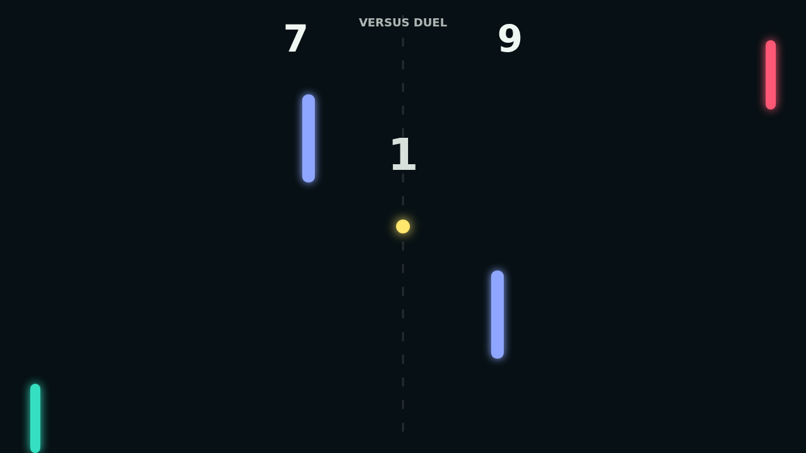

# Carom

Carom turns the familiar paddle duel into a bank-shot fight. The ball snaps between bright paddles on a dark field, then threads through two fixed obstacles that turn every return into a choice: clear it cleanly, or carve it into a wall and let the rebound do the work.

Spin is the heart of the match. Move a paddle as it connects and the ball keeps bending after the hit, making a straight lane suddenly curl toward a corner or drift behind an obstacle. The best rallies feel readable for a split second, then wonderfully unfair in motion.

Solo mode gives you a steady AI opponent that tracks incoming shots and retreats to center when the attack fades. Versus mode puts both paddles on the keyboard for a local duel where the score climbs to 11, but only a two-point lead closes the match.

Every point resets into a tense one-second hold at center court. By match point, the field feels smaller, the obstacles feel bigger, and a single spun carom can decide the whole table.
